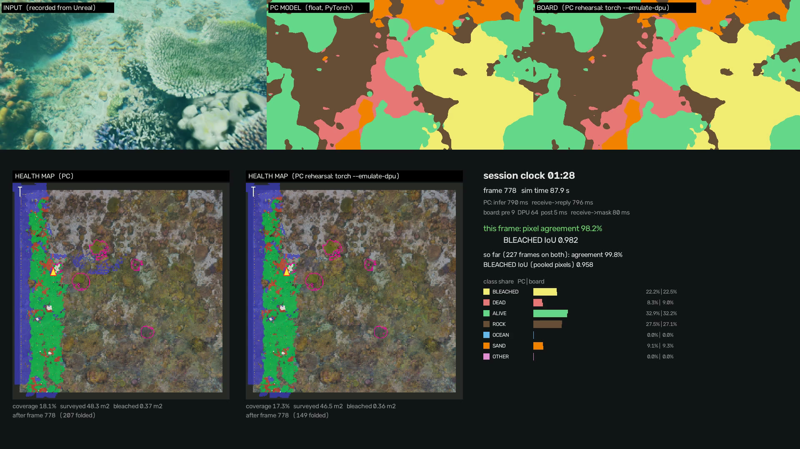

# ReefWatch on the Kria KV260

The board side of the simulator. Unreal streams camera frames plus the capture pose to the board
over Ethernet, **one way**, the way a camera and a navigation unit would. The board runs the
segmentation model on the DPU, runs the 2.5D reef-health map on the ARM cores, and saves the
results on the board. By default nothing goes back on the frame socket. For plotting on the PC
there is an optional status port that the board only writes to. In the final product nothing goes
back at all.

**Reply mode (`--reply`, opt-in).** For demos the board can also answer every request on the same
socket with the response the PC detection server sends (mask, class fractions, stats, health-map
metrics, minimap). Unreal then runs in its **normal** mode (no `-sendonly`) and shows the board's
masks on HUD screen B and the board's map, with no change on the Unreal side. See section 9.
Without `--reply` the program behaves exactly as before.

**Setting up a freshly flashed board (Kria Ubuntu 22.04): [`SETUP_UBUNTU.md`](SETUP_UBUNTU.md).**

```
PC (Unreal, send-only)                          KV260 (python3 -m reefwatch_board)
  SegCapture 640x360 @ 10 Hz + pose  --TCP 5556, CSG2, one-way-->  receiver -> newest-frame slot
                                                                    -> preprocess (int8 LUT, reflect pad)
                                                                    -> DPU (VART) -> argmax -> 7->4 health ids
                                                                    -> health map (<= 3 folds/s)
                                                                    -> out/board_<date>_<time>/  (every 60 s,
                                                                       on disconnect, on exit)
  board/tools/viewer.py  <--TCP 5557, status JSON + minimap PNG, <= 1/s (optional)--
```

**What has run, and what has not.** Everything in this folder has run on the dev PC: the
receiver, the pipeline with backends `none` and `torch`, the map, saving, the status port and the
viewer, end to end with Unreal in send-only mode (numbers in `docs/FPGA_INTERFACE.md`). The
`vart` backend has run on the PC with the **real** Vitis AI 3.5 `xir` + `vart` Python bindings,
the DPU subgraph executed by VART's CPU reference runner (section 7), and through a fake
`vart`/`xir` shim. **No line of it has run on a KV260 yet.** The DPU overlay, the bindings on
the board image, the fingerprint match, the board fps and on-board accuracy all have to be
checked on the board. See "First 15 minutes" below.

Since then the team ran it on a KV260 under **PetaLinux 2022.2 / VART 3.0**: pre 23 + DPU 60 +
post 37 ms per frame, about 8 fps, a map fold about 0.6 s (hence `--map-hz 1`), 21 of the then 22
tests passing (the 22nd had a fixed-time wait that the A53 missed; all waits are now conditions).
The board has since been reflashed with Kria Ubuntu 22.04, where nothing has run yet. Reply mode
has run only on the dev PC (section 9).

## What is in here

| path | what |
|---|---|
| `reefwatch_board/` | the board program (numpy only; Python 3.8+, written for the Kria Ubuntu 22.04 Python 3.10) |
| `reefwatch_board/receiver.py` | CSG2 receiver on 0.0.0.0:5556 (one-way unless `--reply`). One client at a time; a new connection replaces the old one. A reader thread drains the socket into a single newest-frame slot (drops are counted) |
| `reefwatch_board/reply.py` | `--reply` only: per-connection writer thread that answers each request (section 9) |
| `reefwatch_board/backends.py` | `none` (constant mask, pipe test), `vart` (DPU), `torch` (PC A/B only) |
| `reefwatch_board/prepost.py` | int8 input lookup table + reflect padding, crop + argmax, 7->4 collapse table |
| `reefwatch_board/pipeline.py` | inference thread, map thread (newest item, max rate), saver |
| `reefwatch_board/status.py` | status port 5557 (any number of viewers; never blocks the pipeline) |
| `models/` | the two milestone xmodels (512x768 default, 512x1024) + `TENSORS_*.md` + `*.meta.json` |
| `run_board.sh` | starts the program on the board (`PYTHON=... ./run_board.sh` for another interpreter) |
| `SETUP_UBUNTU.md` | Kria Ubuntu 22.04: VART, the B4096 DPU, numpy, firewall, static IPv4 |
| `docs/PROTOCOL.md`, `docs/FPGA_INTERFACE.md` | the wire contract and the board design |
| `tools/stream_frames.py` | PC: streams CSG2 frames one-way along the survey route (no Unreal needed) |
| `tools/viewer.py` | PC: prints the board status, saves the latest minimap, live matplotlib window |
| `tools/record_stream.py`, `tools/replay_stream.py` | PC: record what Unreal sends to a `.csgrec` file, and play it to the board one-way (stdlib only) |
| `tools/make_run_video.py` | PC: video of a board `--log-frames` run (input, DPU mask, health map) |
| `tools/make_compare_video.py` | PC: a PC game session vs the board replay of its recording, frame by frame (section 8) |
| `tools/measure_board_path.py` | PC: board pre/post-processing vs the PC server, on real frames (needs the full simulator runtime + torch) |
| `tools/check_dpu_reference.py` | board: DPU output vs the PC's bit-exact reference for the Unreal frame (expect max \|d\| 0) |
| `tools/fake_vitis/` | PC: fake `vart`/`xir` for tests |
| `tools/run_tests.bat` | PC: the tests with a given interpreter |
| `tests/` | unittest, numpy only (`python3 -m unittest discover -s tests -v`) |

The program imports `reefwatch_runtime.protocol` and `reefwatch_runtime.healthmap` from
`../runtime/` and reads the map inputs from `../data/` (the DEM, the synthetic bleaching ground
truth and the survey route). That is the layout of the ReefWatchSim simulator repo, of the bundle
its `tools/make_bundle.py` builds, and of the team repo's `fpga-board` branch:

```
<repo>/board/     this folder
<repo>/runtime/   reefwatch_runtime/{__init__,config,protocol}.py + healthmap/  (torch-free subset)
                  tests/data/auv_frame_640x360.png  (a real Unreal frame, for tests and stream_frames)
<repo>/data/      healthmap/dem.npz, healthmap/gt_bleached.npz, survey/tabuhan_p1_lawnmower.json
```

`healthmap` writes its PNGs with Pillow when Pillow is installed and with a built-in zlib encoder
when it is not.

The ReefWatchSim repo's copy of this folder also has PC-only tools that the team branch leaves
out: `tools/make_bundle.py` (tar.gz for the board), `tools/vitis_cpu_ref/` (the `vart` backend on
real xir/VART with the CPU reference runner, WSL docker), `tools/arm_container_test.sh` (arm64
Ubuntu under qemu) and `tools\run_board_local.bat` / `tools\run_sim.bat` at its top level.

### Models

| file | input (HxW) | use |
|---|---|---|
| `coral_milestone_7c_512x768.xmodel` | 512x768 | **default.** The milestone checkpoint. The 640x360 frame is reflect-padded to 768x512 exactly as the PC server pads it |
| `coral_milestone_7c_512x1024.xmodel` | 512x1024 | the same checkpoint at the CoralScapes frame size. For sim frames it pads 1.8x the area and agrees less with the PC server (93.9 % vs 98.7 % of pixels on the Unreal test frame) |
| `coral_m7c_e2allcs_s0.xmodel` | 512x1024 | an older sibling checkpoint (same architecture). Kept for comparison only |

All three target `DPUCZDX8G_ISA1_B4096` (Vitis AI 3.5) and have one DPU subgraph.
- Input: `[1,H,W,3]` int8 NHWC RGB, fix_point 5.
- Output: `[1,H,W,7]` int8 NHWC, fix_point 3. It is already full resolution: the network's final
  4x bilinear resize was turned into a transposed conv that runs on the DPU.
- The compiled graph's only CPU op is a fix2float conversion, which the program does not need:
  it takes the argmax on the int8 values directly.

The program reads all of this from the xmodel's tensors, so it does not hard-code any of it.
Copy new builds into `models/` and pass `--xmodel` (or name the file
`coral_milestone_7c_512x768.xmodel`).

## 1. Cable and static IPs

Connect a normal Ethernet cable from the PC to the KV260's RJ45 port (both ends auto-negotiate
crossover). Plan: **PC 192.168.1.1/24, board 192.168.1.2/24**, no gateway.

> If the PC's Wi-Fi or another adapter is already on a 192.168.1.x network (many home routers
> are), the two routes clash. Either turn that adapter off for the session, or use another
> subnet on both ends, e.g. 192.168.50.1 and 192.168.50.2.

### Windows (PC)

Settings: Settings > Network & internet > Ethernet > **IP assignment: Edit** > Manual > IPv4 on.
Enter IP address `192.168.1.1`, Subnet mask `255.255.255.0` (or prefix length 24), and leave
Gateway and DNS empty. Save.

Or, in an **administrator** console:

```bat
netsh interface ipv4 show interfaces
rem use the Name of the wired adapter from that list, e.g. "Ethernet" or "Ethernet 2"
netsh interface ipv4 set address name="Ethernet" static 192.168.1.1 255.255.255.0
netsh interface ipv4 show addresses name="Ethernet"
rem afterwards, back to automatic:
netsh interface ipv4 set address name="Ethernet" source=dhcp
```

Windows Firewall needs no change: both connections (Unreal to 5556, viewer to 5557) go out from
the PC. Windows does block incoming ping by default, so ping from the PC to the board, not the
other way.

### Board (Linux)

No network yet? Use the serial console. The KV260's micro-USB port carries a USB-UART: open the
second-numbered COM port in PuTTY at 115200 8N1. The default user is `ubuntu` on the Kria Ubuntu
image and `petalinux` on PetaLinux.

```sh
ip -br link                                   # find the wired interface (eth0 on the Kria images)
sudo ip addr add 192.168.1.2/24 dev eth0      # temporary, gone after reboot
sudo ip link set eth0 up
ip -br addr show eth0
```

To make it permanent on Ubuntu, first look at what manages the network (`ls /etc/netplan/`,
`nmcli general` if NetworkManager is installed).

- netplan: create `/etc/netplan/60-reefwatch.yaml`, then `sudo netplan apply`:

  ```yaml
  network:
    version: 2
    ethernets:
      eth0:
        dhcp4: false
        addresses: [192.168.1.2/24]
  ```

  This turns off DHCP on eth0. Remove the file and run `netplan apply` again to plug the board
  back into a router.
- NetworkManager:
  `sudo nmcli con add type ethernet ifname eth0 con-name reefwatch ipv4.method manual ipv4.addresses 192.168.1.2/24 && sudo nmcli con up reefwatch`.
- PetaLinux: `ifconfig eth0 192.168.1.2 netmask 255.255.255.0 up`, or the same `ip addr` lines.

## 2. Ping and ssh

```bat
ping 192.168.1.2
ssh ubuntu@192.168.1.2
```

## 3. Copy the program to the board

**From the team repo** (board with internet; the repo is public):

```sh
git clone --branch fpga-board --single-branch https://github.com/chgaobt/ReefWatch.git
cd ReefWatch/board
chmod +x run_board.sh        # git keeps the bit; only needed if the checkout lost it
```

(`--single-branch` still downloads the 90 MB `segmentation/` weights of `main`'s history; add
`--depth 1` for the smallest download.) Without internet on the board, clone on the PC and
`scp -r ReefWatch ubuntu@192.168.1.2:~`, keeping the `board/`, `runtime/`, `data/` layout.

**From the ReefWatchSim repo** (the bundle). On the PC (this builds one tar.gz with every
xmodel in `board/models/`; delete the models you do not need first to shrink it):

```bat
python board\tools\make_bundle.py
scp out\board_bundle\reefwatch_board.tar.gz ubuntu@192.168.1.2:~
```

On the board:

```sh
tar xzf reefwatch_board.tar.gz
cd reefwatch/board
```

(`python` here means the PC interpreter set up as in `runtime/README.md`, e.g. the uv Python with
the CoralCapstone site-packages on `PYTHONPATH`. `make_bundle.py` needs only the standard library.)

To copy by hand instead, keep the same layout under one folder:
`board/{reefwatch_board,run_board.sh,models,tests,tools/stream_frames.py}`,
`runtime/reefwatch_runtime/{__init__.py,config.py,protocol.py,healthmap/}` and
`data/healthmap/{dem.npz,gt_bleached.npz}`, `data/survey/tabuhan_p1_lawnmower.json`.

## 4. First 15 minutes on the board

1. **What image is this?**
   ```sh
   cat /etc/os-release          # expect Ubuntu 22.04 (Kria image); PetaLinux is the less likely alternative
   python3 --version            # expect 3.10 on Kria Ubuntu 22.04
   ```
2. **numpy** (the only package the program needs):
   ```sh
   python3 -c "import numpy; print(numpy.__version__)"
   ```
   If it is missing:
   - With internet on the board: `sudo apt install python3-numpy`, or `python3 -m pip install numpy`.
   - **Offline**, on the PC: download the aarch64 wheel matching the board's Python (3.10 here),
     then copy it over:
     ```bat
     python -m pip download numpy==1.26.4 --only-binary=:all: --platform manylinux2014_aarch64 --python-version 3.10 -d wheels
     scp wheels\numpy-1.26.4-cp310-cp310-manylinux_2_17_aarch64.manylinux2014_aarch64.whl ubuntu@192.168.1.2:~
     ```
     On the board, `python3 -m pip install --no-index ~/numpy-1.26.4-*.whl`. If the board has no
     pip either, unpack the wheel (it is a zip and bundles its own BLAS) and point Python at it:
     ```sh
     python3 -c "import zipfile,glob; zipfile.ZipFile(glob.glob('/home/ubuntu/numpy-*.whl')[0]).extractall('/home/ubuntu/pyvendor')"
     export PYTHONPATH=/home/ubuntu/pyvendor
     ```
     The apt route also works offline: download the jammy arm64 `python3-numpy` .deb from
     packages.ubuntu.com and `sudo dpkg -i` it. It may ask for dependency .debs (BLAS/LAPACK),
     which is why the wheel is the easier offline path.
3. **Vitis AI runtime and the DPU** (these steps depend on the board image, so check them there;
   on Kria Ubuntu 22.04 follow [`SETUP_UBUNTU.md`](SETUP_UBUNTU.md), which covers installing
   them):
   ```sh
   python3 -c "import vart, xir; print('VART OK')"
   sudo xmutil listapps         # which accelerator apps exist, and which is active
   xdputil query                # DPU present? its fingerprint / target
   ```
   - `xdputil query` must report a **DPUCZDX8G B4096** DPU with fingerprint
     **0x101000056010407** (the value the xmodels were compiled against). These xmodels target
     `DPUCZDX8G_ISA1_B4096`, and a DPU with a different configuration (for example the B3136 in
     some Kria example apps) refuses the model with a fingerprint mismatch.
   - If no DPU is loaded, load one with `sudo xmutil unloadapp` then
     `sudo xmutil loadapp <app with a B4096 DPU>`. The team has run an xmodel on this board
     before: load the same app that run used.
   - If `import vart, xir` fails, the board has the C++ runtime without the Python bindings, or
     the bindings are installed for another Python. Find them
     (`find / -name "vart*.so" -path "*python*" 2>/dev/null`) and use that interpreter. Until
     then, `--backend none` still tests the network and the map.
4. **Unit tests** (numpy only; the Vitis-dump and torch tests skip):
   ```sh
   cd ~/ReefWatch/board && python3 -m unittest discover -s tests -v     # (bundle: ~/reefwatch/board)
   ```
   Every wait in the tests is on a condition with a 60 s deadline (`BOARD_TEST_TIMEOUT=120` for
   more), so the slow A53 passes them too.
5. **Pipe test (backend `none`)**: on the board, `./run_board.sh`. Wait for
   `READY on 0.0.0.0:5556`. Then on the PC either
   ```bat
   tools\run_sim.bat -sendonly -segserver=192.168.1.2
   rem or, without Unreal:
   python board\tools\stream_frames.py --host 192.168.1.2 --reset
   ```
   The board prints `rx ~10 fps`, `drop 0` and the map coverage rising. The Unreal HUD shows
   `STREAMING TO 192.168.1.2:5556 · 10 fps sent`. On the PC, run
   `python board\tools\viewer.py --host 192.168.1.2` to watch the map.
6. **DPU (backend `vart`)**: Ctrl+C the board program, then `./run_board.sh --backend vart --map-hz 1`. The
   start-up lines print the xmodel's input/output shapes and fix points. They should read
   `[1,512,768,3]` fp 5 and `[1,512,768,7]` fp 3. In the status line, `dpu` is the time of
   `execute_async` + `wait`, while `pre` and `post` are the ARM's share (LUT + pad, crop + argmax
   + stats). Stream again as in step 5.
   **Bit-exactness**: `python3 tools/check_dpu_reference.py` runs the stored int8 input of the
   Unreal frame on the DPU and compares the int8 logits with the PC reference. Expect `max |d| 0`
   (the PC reference equals vai_q's simulation bit for bit; nothing has yet compared it with a DPU).
7. **Benchmark the DPU alone**:
   `xdputil benchmark models/coral_milestone_7c_512x768.xmodel -i -1 1` (UG1354's form:
   `-i -1` = the whole graph, then the thread count; check `xdputil benchmark --help` on this image).
8. **Masks back to Unreal (reply mode)**: `./run_board.sh --backend vart --map-hz 1 --reply`,
   then on the PC `tools\run_sim.bat -segserver=192.168.1.2` (no `-sendonly`). See section 9.
9. When you stop the program, it saves the map in `out/board_<date>_<time>/`. Copy it back with
   `scp -r ubuntu@192.168.1.2:~/ReefWatch/board/out .`

## 5. Running it

```sh
./run_board.sh [--backend none|vart] [options]          # = python3 -m reefwatch_board
```

| option | default | meaning |
|---|---|---|
| `--backend` | `none` | `none` = pipe test, `vart` = DPU, `torch` = PC only |
| `--xmodel` | `models/coral_milestone_7c_512x768.xmodel` | vart model |
| `--host`, `--port` | `0.0.0.0`, `5556` | frame socket (one-way unless `--reply`) |
| `--reply` | off | answer every request on the frame socket (section 9); for Unreal **without** `-sendonly` |
| `--reply-timeout` | `2` | seconds one response may take to send before that client is dropped |
| `--server-name` | by backend | name sent in `SERVER_INFO` (the Unreal HUD's mask-source label) |
| `--status-port`, `--no-status` | `5557` | viewer port; off with `--no-status` |
| `--map-hz` | `3` | map folds per second at most (the newest posed frame is folded; frames in between only miss the map). **Use 1 on the KV260** (a fold takes ~0.6 s on the A53) |
| `--minimap-hz` | `1` | minimap renders for the status port |
| `--map-subsample`, `--map-range`, `--map-min-obs` | 4, 3.5 m, 3 | as on the PC server |
| `--dem`, `--gt`, `--no-gt`, `--no-map` | `data/healthmap/*.npz` | map inputs. The GT (synthetic bleached colonies) adds IoU/P/R |
| `--seven-to-health` | `health` | 7->4 collapse (DEAD+ROCK -> DEGRADED), as the PC server |
| `--out`, `--save-every` | `out/board_<stamp>`, 60 s | map artifacts + `status.jsonl` |
| `--warmup-res` | `640x360` | one throw-away frame before READY |
| `--exit-after S`, `--exit-on-disconnect` | off | scripted runs |

One status line per second:

```
[board] rx 10.02 fps 6.9 MB/s drop 0 | infer 45.10 ms (pre 6.0 dpu 30.1 post 9.0) 10.02 fps | map 3.0/s 210 ms cov 12.3% bleached 0.42 m2 | frames 1234 | 192.168.1.1:50123
```

`drop` counts frames received but replaced before the pipeline took them (the board fell
behind). The sender is never slowed: the socket is drained continuously.

Outputs in `--out`, written every `--save-every` seconds, when the client disconnects and on
exit:
- `healthmap_state.npz`, `class_map.png`, `minimap_final.png`;
- `metrics.json`: MAP_METRICS plus the board counters;
- `status.jsonl`: one line per second.

## 6. Watching from the PC

```bat
python board\tools\viewer.py --host 192.168.1.2                   live window (needs matplotlib)
python board\tools\viewer.py --host 192.168.1.2 --no-plot --log board_status.jsonl
```

It prints each status line, keeps the latest minimap in `board_minimap.png` and reconnects if the
board restarts. Status port format, little-endian: `"RWST"`, `json_len u32`, `png_len u32`,
then the JSON and the PNG. The PNG is the minimap and is sent only when it has changed.

## 7. Rehearsing on the PC

`tools\run_board_local.bat` runs this program on the PC: torch backend by default (the PC GPU
stands in for the DPU), `--backend none` for the pipe alone, and `--emulate-dpu` to run the
board's own int8 pre-processing and argmax around the float model. Then run
`tools\run_sim.bat -sendonly -segserver=127.0.0.1` and the viewer on 127.0.0.1.

`--emulate-dpu` is float inside the network, and INT8 changes the answer: on 20 Unreal frames the
INT8 model (below) agrees with the float emulation on 92 % of pixels (min 47 %, mostly DEAD ->
ALIVE), BLEACHED IoU between them 0.47, INT8 marking about twice as many pixels BLEACHED. The
emulation only checks the board's pre/post-processing. Two PC paths run the INT8 model:

- **Real VART, CPU runner** (WSL docker `xilinx/vitis-ai-pytorch-cpu`, ~3.2 s per frame):
  `tools/vitis_cpu_ref/run_in_docker.sh` (header has the commands). `build_ref_xmodel.sh`
  recompiles vai_q's graph with `--reserve_const_data`, refusing the result unless its DPU program
  (mc_code) is identical to `models/*.xmodel`; `ref_launch.py app --backend vart ...` runs this
  program unchanged except that `create_runner(sg, "run")` becomes mode `"ref"`. Two of the
  image's CPU op implementations disagree with vai_q (`opfix/*.cpp` replaces them); with those, all
  93 dumped tensors and the output match vai_q's golden dump bit for bit, and vai_q test mode
  matches it on 20 frames.
- **Fake shim**: `PYTHONPATH=board\tools\fake_vitis;...` then `--backend vart`. The fake `xir`
  answers from `fake_vitis/specs/*.json` (written by the real xir, md5-checked); the fake `vart`
  replays the reference output (`FAKE_VART_REPLAY=board\tests\data\dpu_ref_auv_frame_512x768.npz`,
  exact for the frame `stream_frames.py` sends), else the float model; `FAKE_VART_DPU_MS=80`
  rehearses the board's DPU time.

## 8. Comparing a PC session with the board

Every game started with `tools\play.bat` is recorded by the PC detection server
(`out\sessions\<date_time>\`): `recording.csgrec` holds every CSG2 request Unreal sent, byte for
byte with its arrival time, and `pc\frames\` holds every PC mask and minimap in the same format
the board writes with `--log-frames`. Replay the recording to the board, then compare:

```bat
(board)  ./run_board.sh --backend vart --log-frames --exit-on-disconnect --out out/replay_<name>
(PC)     python board\tools\replay_stream.py out\sessions\<date_time>\recording.csgrec --host 192.168.1.2
(PC)     copy the board's out/replay_<name> folder back, then
         python board\tools\make_compare_video.py out\sessions\<date_time> <copied folder>
```

`make_compare_video.py` joins the two sides by frame_id and writes, in the board folder,
`compare_video.mp4` (input | PC float mask | board INT8 mask, plus both health maps on the PC
session clock; a frame the board skipped shows its last mask, labelled), `compare.json` (pixel
agreement, per-class IoU with the PC as reference, BLEACHED IoU, the same in the 4 health
classes, both confusion matrices, both final map summaries) and `compare_frames.csv` (agreement
and BLEACHED IoU per frame). Agreement counts only frames both sides processed.
`--board-label` names the board side in the video.

Rehearsal without the board (the board program on the PC, float model with the board's int8
pre/post; label it as such, it is not the INT8 DPU):

```bat
tools\run_board_local.bat --backend torch --emulate-dpu --log-frames --exit-on-disconnect --out out\rehearsal
python board\tools\replay_stream.py out\sessions\<date_time>\recording.csgrec --host 127.0.0.1
python board\tools\make_compare_video.py out\sessions\<date_time> out\rehearsal --board-label "PC rehearsal: torch --emulate-dpu"
```

PC session 20261027_014735 (90 s auto survey, 259 frames) against a PC rehearsal of the board: pixel
agreement 99.7 %, BLEACHED IoU 0.95 (the rehearsal is float inside the network, so this checks the
plumbing, not INT8).



## 9. Reply mode: the board's masks on the Unreal HUD

```sh
(board)  ./run_board.sh --backend vart --map-hz 1 --reply
(PC)     tools\run_sim.bat -segserver=192.168.1.2 -segport=5556        (NOT -sendonly)
```

(`tools\run_sim.bat` is in the ReefWatchSim repo. `tools\play.bat` does not fit here: it starts
the PC detection server and points the game at it.)

Unreal's normal client then treats the board exactly like the PC detection server: screen B shows
the board's mask (4 health colours), the class bars show its fractions, the minimap and the
world overlay show the board's health map, and `AUVPERF` lines in the Unreal log report
`seg_fps`, `rtt` and `e2e`. Nothing changes on the Unreal side. The board's status line adds
`tx <fps> <MB/s>`, and `metrics.json` gains a `replies` block.

**What is sent, when.** Unreal keeps one request in flight and closes the connection if no
complete response arrives within 2 s of sending. On the board:

1. The reader thread registers each request with the connection's writer (in arrival order) and
   hands the frame to the same newest-frame slot as in one-way mode.
2. The pipeline thread runs pre + DPU + post, then appends the ids to the writer's list (no
   socket call), then posts to the map thread as before.
3. The writer thread colours the mask with the PC server's palette, packs the CSG2 response
   (`MASK_RGBA`, `CLASS_FRAC`, `STATS`, then `MAP_METRICS` and, when the client asked and a new
   one exists, `MINIMAP_PNG`) and sends it. CSEG v1 requests get v1 responses.

So request N is answered with frame N's own mask (`frame_id` echoed) as soon as it is ready:
about pre + DPU + post + 10 ms after it arrived (~130 ms on the KV260 by the PetaLinux numbers,
far inside 2 s). With one request in flight the slot never drops a frame, so the board runs at
the rate of the round trip (~7 fps on the KV260 by those numbers; the PC rehearsal reached 10).
The map folds on its own thread at `--map-hz`, so `MAP_METRICS` lags the mask, as on the PC
server, and the map never delays a mask. A request that `RESET_MAP` cleared gets no map metrics
until the map thread has applied the reset (no stale map after a reset).

**Slow or dead client.** In reply mode the socket gets a timeout (`--reply-timeout`, 2 s, the
client's own deadline). A response that cannot be sent within it, or a send error, closes that
connection; the reader ends, the map is saved as on any disconnect, and Unreal reconnects with its
usual backoff. More than 64 unanswered requests (a client that never reads, such as
`replay_stream.py`) also closes it. The pipeline only ever appends to a list, so it never waits on
a socket. Use one-way mode (no `--reply`) for `replay_stream.py` and `-sendonly`.

**Exactly one response per request.** If a client pipelines requests and a frame is replaced in the
slot before the pipeline took it, that request is answered with the next finished frame's mask,
whose `frame_id` the response carries (counted as `reused`). An inference error is answered with an
all-OTHER mask plus an `ERROR` block, so the client stays in step.

**Streaming (Unreal's "Real time" detection display).** Requests that carry the `STREAM_REPLIES`
flag are answered under the `processed` policy instead: Unreal sends at camera rate and never
waits, the board answers only the frames its pipeline actually ran (replaced frames get no
response, counted as `skipped`), each with a `FRAME_INFO` block (frame_id, capture world time,
receive -> ids-ready time, this connection's received / inferred / skipped counts). The first such
response also carries `SERVER_INFO`, the name the HUD shows as the mask source: `KV260 DPU` with
`--backend vart`, `Board program (torch, emulated DPU)` in the PC rehearsal, or `--server-name`.
Nothing to switch on the board: `--reply` serves both kinds of client, per request. The status
line adds `streamed`; `metrics.json` `replies` gains `streamed` and `skipped`.

```sh
(PC)     tools\run_sim.bat -segserver=192.168.1.2 -detectmode=realtime      (or realtime_mc, synced)
```

Measured on the dev PC (2026-11-02, the board program with `torch --emulate-dpu` and `--map-hz 1`,
Unreal on the same machine in normal mode, `-autosurvey`): see `docs/FPGA_INTERFACE.md`,
"Reply mode".
